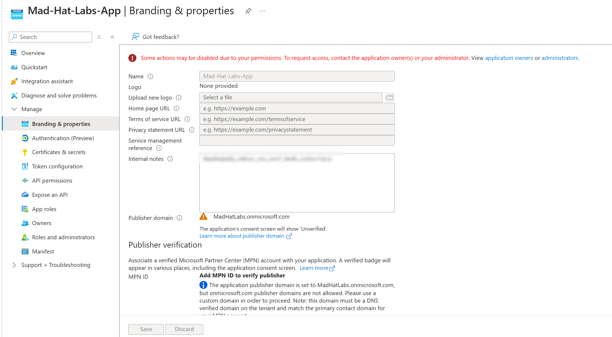
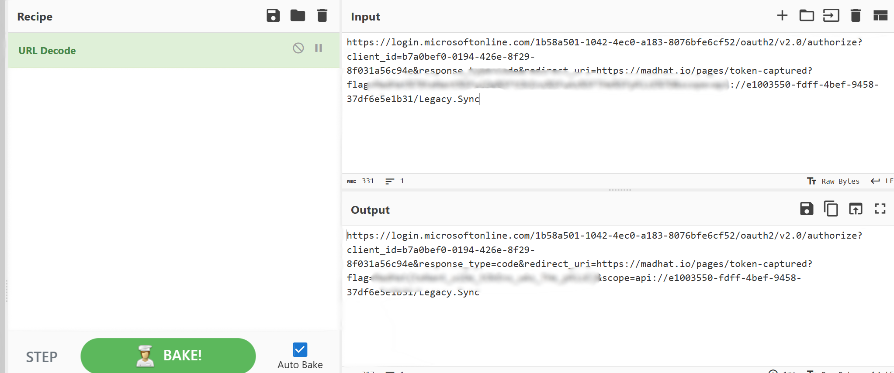

# A user's app approval that survived the password reset

## Scenario

The ticket in this live multi-user Azure training tenant was a standard user in accounting who was phished, completed multi-factor authentication, and had that signed-in session stolen. I reconstructed how the session became a durable OAuth consent-phishing path across a legacy connector app and a second app the attacker registered, where a person who is already signed in is led to approve an application. The question on the ticket was how the access survived a normal containment playbook (case name: The Stolen Identity). This case is identity and access management work: who can get in, what they can touch, and what still works after a password reset.

## Environment

- Microsoft Entra ID, the sign-in directory, in a live multi-user Azure training tenant. This write-up is that training exercise.
- App registrations.
- Reader on directory apps.

## Investigation

I followed the two apps in five stages.

1. Entry. The directory keeps a listing for each application it allows to sign in and call the organization's services, called an app registration, and an Owner of that listing can change the application's credentials. I opened the legacy connector app in the portal and read the notes on Branding & properties. The note recorded the entry. The accounting user had been phished and had completed multi-factor authentication, so the stolen session already included proof that the check had succeeded, and Conditional Access, the rules that allow a sign-in when those conditions are met, let it through. That user was still an Owner on the legacy connector app. The assignment had never been removed, which is access drift. The note stays out of this write-up.

I started with the old connector app because that is the object the ticket said had been changed. The notes page, Branding & properties, is where someone recorded how the attacker got in: a stolen sign-in that was already approved, plus ownership that had been left in place. That record is the decision to stay on this app, and the leftover ownership is what the ticket hands me for the next page.


*The legacy app's properties page, where the investigation note was recorded. The note itself is blurred.*

2. Escalate. I opened Certificates & secrets. An application has its own password, called a client secret, and anyone who holds it can sign in as the application. Under Client secrets, a new one was on the list. The Expires column was the signal: the date sat nearly a century out, which marks a credential planted for persistence. The text written on that secret stays out of this write-up. The application then acts under its own directory identity, called a service principal, and that sign-in receives the permissions already granted to the application. Owner on the legacy app was enough for the attacker to authenticate that way and continue without another sign-in as the accounting user.

Ownership is the right to change the app's password, so the secrets page was the next click after that leftover ownership. A new password, on Certificates & secrets, is how the ownership becomes the app's own power. The far-off expiry is the decision on this page: this is not a normal key.


*The app's password list. The expiry date, 12/31/2099, is the problem.*

3. Pivot. Each action the application may take against directory and user data is granted on its own, called an API permission, and an attacker signed in as the application can use every action an administrator has already approved. I read that list on the legacy app. Those actions ran through Microsoft Graph, the interface for directory and user data. They belonged to the application itself, and an administrator had already approved them, recorded as admin consent, so they were live. That list was the blast radius: how far a sign-in as the application could reach. Owners also listed a service principal for a second app the attacker had registered. The default directory setting lets a standard user register an app, so that second app was created without an administrator. Ownership outlives any one secret. After the first secret is rotated, the Owner can create another.

A password can be deleted, so the owner list was the next page after the secret. Another application sitting there means deleting the password does not end the access. The permissions page, API permissions, answers what that power actually is.


*The only owner is another application, not a person. That is what lets a deleted password be replaced.*



*The second application, the one listed as owner. Its notes are blurred.*

4. Persist. I opened Expose an API on the legacy app. A named action another application is allowed to request, called a scope, was published there, and it lets the attacker's app ask the legacy app to perform that action for a signed-in user. The scope's name stays out of this write-up. Rotating the client secret leaves this request available. The attacker asks for that delegated access, access exercised as the user, from their own app.

Expose an API is the backup that still works after the password is gone, which is why I opened it after finding the second application on the owner list. It turns the old app into something the attacker's app can call. The decision on this page is that removing the password leaves that path open.


*A custom permission published on the legacy app, which lets another app request access. The permission's user-facing name is blurred.*

5. Loot. I opened Authentication on the attacker-created app. The address the sign-in system sends the person to after they accept, carrying the authorization code that proves they accepted, is called a redirect URI, and the party that controls the address receives that code. One registered address was the kind used for local development. Another pointed at attacker-controlled infrastructure. The attacker-created app's client id, its public identifier, together with that redirect URI and the exposed scope, is what a consent-phishing URL is built from. A person already signed in on a company device accepts the consent prompt, and the authorization code is sent to that redirect. I confirmed the suspicious redirect by reading it. A URL-encoded value had to be decoded before I could read it. The decoded value and the address stay out of this write-up.

The return address is where the proof of "Accept" is sent, so I opened Authentication on the second app. That address connects the second app to a person who is already signed in, which is how the call from the previous page reaches someone. Resetting the password does not undo that Accept.



*The sign-in link, with the sensitive value blurred, before and after decoding.*

I read the link as three values the attacker already held, written out as one address. One is the public identifier of the second app. One is a return address on a server the attacker runs. One is the custom permission the old app had made available for other apps to request. With the real values removed, the address has this shape:

```
https://{sign-in-service}/{company-directory}/authorize?client={second-app-id}&return={attacker-return-address}&permission={old-app-permission}
```

Accept is the click that matters. It is made by someone whose work sign-in is already open on a company computer. Microsoft answers by sending a code that works once to the return address in that link. The attacker's server gives the code back and receives a short-lived pass, called a token. The token lets the attacker act in that person's name, and the only action it covers is the permission the old app published. The wide access the old app holds over the company directory sits on the old app, not in the token. The token can still ask the old app's own service, the part that does the work, to run a sync, and that service is allowed to carry it out. That is a confused deputy. The company trusts the old app, so the app treated the sync as its own job and went ahead with a request it should have declined.

The link is worth more than stealing the password again. Using the password means a fresh sign-in on the attacker's computer, and the company checks are still there: the computer has to be one the company issued, the location has to fit the person, and an extra code has to be typed. The person who opens this link is already past those checks, on a company computer. No sign-in is started from the attacker's side. Accept leaves an approval that the second app may keep acting for them. The approval survives a new password, a sign-out of every session, and a fresh requirement for the extra code. Removing it is a separate action someone has to take.

Phishing the password again has to get past device compliance, location, and multi-factor authentication. Consent phishing starts from a person who is already signed in on a trusted device and asks them to approve an application. The directory keeps that approval as a standing record that the application may act for the user, called an OAuth grant (OAuth2PermissionGrant), and a password reset, a session revocation, or enforcing multi-factor authentication leaves the attacker that record. A trusted service that carries out a request it should never have authorized is called a confused deputy, and that let the attacker send the legacy connector app a request the app should have refused. The token from that grant lets the attacker act as the user against that backend. The broad permissions that belong to the application itself stay on the application sign-in.

## What broke / what surprised me

A standard user can register an app under the default directory setting, with no administrator in the path. Owner on an app registration is real privilege. A review aimed at Global Administrators would miss it, because Owner is recorded on the application. A single new secret looks like the whole incident until the Owners list is opened.

## Findings and recommendations

Determined: a five-stage consent-phishing chain on the legacy connector app. A standard user in accounting was phished, completed multi-factor authentication, and was still an Owner through access drift. A client secret expiring nearly a century out had been added. Microsoft Graph application permissions had admin consent. A service principal for the attacker-created app was an Owner. A custom scope was exposed. The attacker-created app had a redirect URI on attacker-controlled infrastructure, beside one that looked like local development.

Recommendations to the resource owner:

- Revoke the client secret on the legacy connector app.
- Remove the rogue service principal from Owners.
- Delete the custom exposed API scope.
- Revoke the OAuth2PermissionGrant explicitly. A password reset, session revocation, and enforcing multi-factor authentication leave the grant in place.
- Remove the attacker redirect URI.
- Review the Microsoft Graph application permissions and reduce them to what the connector still needs.
- Disable the default that lets a user register an application.
- Audit every app's Owners list the same way directory roles are audited.
- Alert on new client secrets and on new redirect URIs.

## What I learned

- The work in this case is identity and access: who can get in, what they can touch, and what still works after a password reset.
- A stolen user session and a client-credentials sign-in, the application signing in with its own secret, are different. The session is what passed Conditional Access. The secret is what let the attacker sign in as the service principal and use the application's permissions without signing in as that person again.
- The OAuth grant is why the access survived. Password reset, session revocation, and enforcing multi-factor authentication end the user's sessions. The grant has to be revoked on its own.
- What I'd do differently: check Owners and Expose an API before calling the secret rotation done. The new secret was the obvious artifact. The ownership and the custom scope are what still worked after that secret was gone.
- Reader on directory apps was enough to see the notes, the secret expiry, the permissions, the owners, the scope, and the redirect URIs.

<!--
**Suggested resume line:** Reconstructed a five-stage OAuth consent-phishing chain across two app registrations in a live multi-user Azure training tenant, from a stolen session that passed Conditional Access, through a long-lived secret on the legacy connector app, an ownership pivot, a custom exposed scope, and an attacker redirect, with remediation that revokes the OAuth grant explicitly.

**Interview angle:** How an attacker still has access after the password is reset, the sessions are revoked, and multi-factor authentication is enforced.
-->
