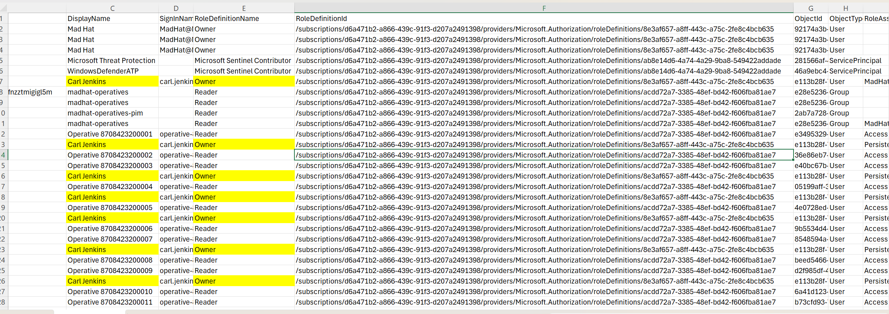
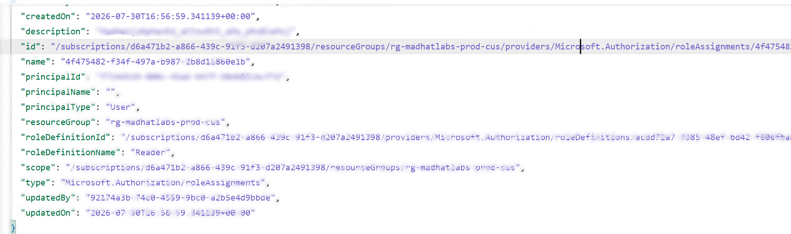
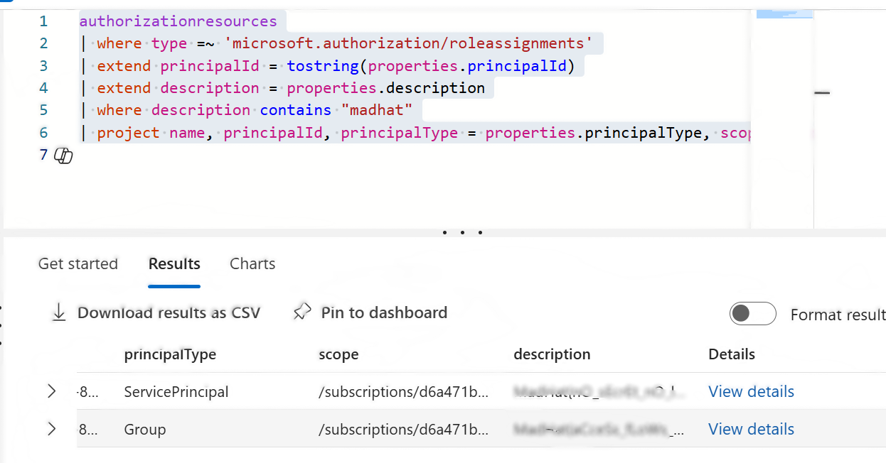
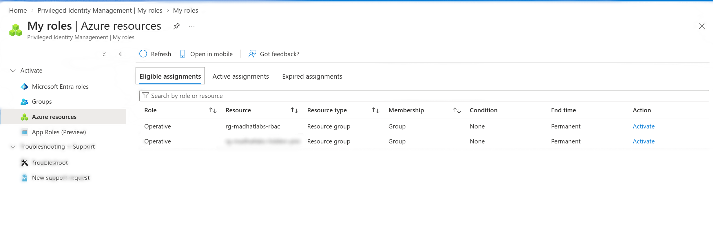
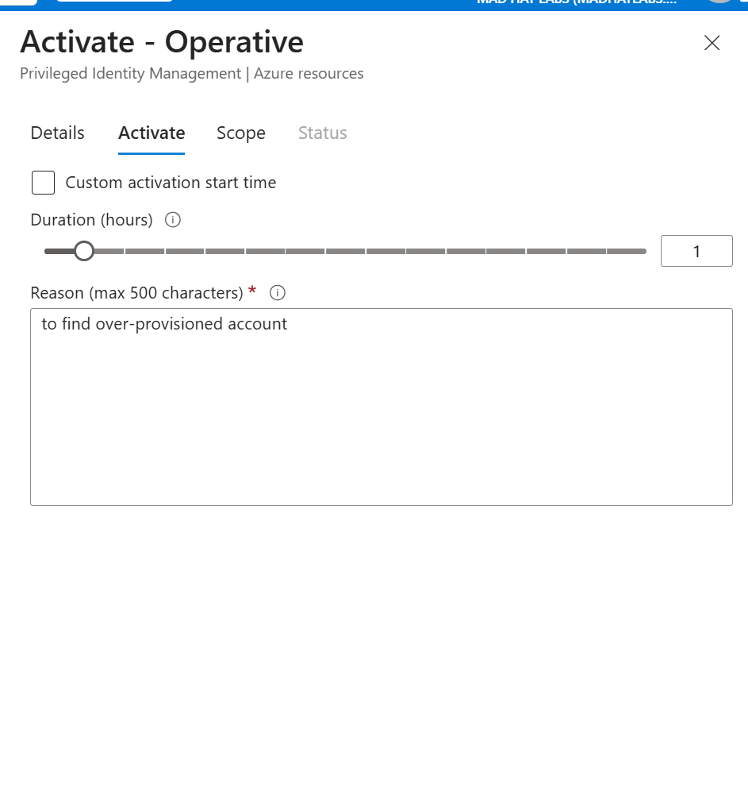
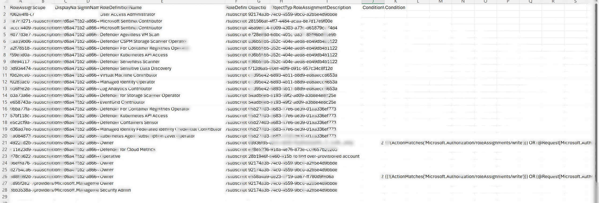

# The blank name that was still a role assignment

I reviewed who can do what in a live Azure training tenant, an Azure environment used for training. It was not production. I started with Reader, which can look at resources and cannot change them, and I held one additional role I was allowed to turn on for a limited time. That on-demand path is Privileged Identity Management (PIM). The review is role-based access control (RBAC): which role is granted, to whom, and at what scope, the boundary the grant covers.

## Scope and methodology

The scope was this training tenant. I listed grants and recorded what each listing leaves out.

The review asked who can still change things, and which of those grants a normal pass through the access page would fail to notice. I used four tools, then a fifth step that none of the tools perform.

I started with the access-control page in the portal, and with an export of the same list. Azure calls that page the Access control (IAM) blade. Each row is a role assignment, the record of a role granted to an account, group, or application. It is the screen a resource owner already has, so it was the correct first pass: active assignments at one scope, including assignments inherited from a wider scope, grants made above this one that still apply here.

I then pulled the same data with Azure CLI, the command-line tool for Azure, so I could run the listing again and retain blank names. A blank name is easy to miss on a long portal page. This command reads one resource group, a set of related resources, in the training tenant:

```
az role assignment list --resource-group rg-madhatlabs-prod-cus
```

The account I was signed in as could not resolve directory names on its own. I cross-checked names against the lesson file for the exercise.

I then ran one tenant-wide query in Azure Resource Graph, which reads resources across the tenant, written in Kusto Query Language (KQL). One resource group per command does not cover a tenant. One query covers the tenant. The rows it returned stay out of this write-up.

I exported PIM to separate eligible assignments from active ones. Eligible means the role is off until someone activates it. The export also carries activation history: who turned a role on, and when.

The fifth step was the hunt. The exercise did not name an account and did not indicate where to look next. I activated the eligible role and looked for an account holding Owner, which is full control of a scope, where the job did not need full control. That grant sat on a resource group I could not see until the eligible role was on.

## Findings

The findings are four classes. No counts, no account names, and no identifiers in this write-up. I ranked a class higher when the power was usable now, and when a review that stopped on the first screen would leave it off the ticket.

1. Over-provisioned Owner on a resource group that stayed out of view until I activated the eligible role. Owner can change everything in that resource group and can grant further access on it. The account had more power than the job required. The assignment carried no marker of that excess. The account name stays out of this write-up.

2. Standing privileged access. Privileged roles were active all the time. A privileged role the job needs only sometimes should be PIM-eligible: off until the person turns it on, with a reason, and with an end time. A standing grant has no activation to read and no automatic end.

3. Orphaned role assignment. The grant is still stored after the principal, the account, group, or application that held the role, is gone. Azure keeps the object ID, a GUID that identifies that principal, on the role assignment, and looks the name up when someone lists access. With the account gone, that lookup comes back empty: `principalName`, the directory name on the assignment, is blank in the CLI, and the portal shows "Identity not found." The row is dormant. It does not serve a living person today. Nobody was monitoring it. If a principal returns with that same object ID, the permissions are already in place.

4. Redundant Owner grants. Owner was assigned across many resources in a pattern that looks copied, by hand or by a script. Owner is the widest built-in role on a resource, a role Azure provides. Repeated Owner is full control in places where a narrower role covers the job.

## What each method misses

The lists disagree, and that disagreement is the audit.

### IAM blade and export

The blade shows active role assignments at the scope that was opened, including assignments inherited from a parent scope. That is who can act on this resource now, as a direct grant or as a grant higher up.

A group appears as one row. The people and applications inside the group are a separate lookup. A group granted Owner can place that power on members this page never names.

An orphaned principal is labeled "Identity not found." On a long export that row sits among resolved names, and a review sorted by name places the blank toward the bottom. The page does not state that the permissions are still attached to the stored object ID.



*Role-assignment export showing the same Owner repeated across many scopes. Groups appear without their members.*

### Azure CLI

The CLI returns the same active assignments, in a form a script can repeat. When the account running the command can resolve other names, an empty `principalName` is the deleted account: the assignment is present, and the name lookup failed.

The published command is one resource group, so one run is one scope. Another resource group, the subscription that contains the resource groups, or a management group above the subscription, is another run. A grant that exists only on a scope the command did not request is absent from that output.

On this exercise the account I was signed in as could not resolve names, so an empty `principalName` was not proof of a deleted account by itself. I used the lesson file to cross-check which principals still existed.



*One assignment whose principalName is empty. Azure kept the object ID after the account was deleted.*

### Resource Graph (KQL)

Resource Graph reads active role assignments across the tenant in one query. This is the query.

```
authorizationresources
| where type =~ 'microsoft.authorization/roleassignments'
| extend principalId = tostring(properties.principalId)
| extend description = properties.description
| where description contains "madhat"
| project name, principalId, principalType = properties.principalType, scope = properties.scope, description
```

The query keeps active assignments whose description matches the filter written above. Eligible assignments are a different record. They are not rows of type `microsoft.authorization/roleassignments`, so this sweep does not list a role that is only eligible. The descriptions on those rows stay out of this write-up.



*The tenant-wide KQL query and its results. Descriptions in the result are already blurred.*

### PIM export

The PIM export is the comparison the other three lists do not make: eligible against active, plus the history of activations. It is the appropriate record for privilege that has been brought under PIM.

Standing assignments that were granted outside PIM have no eligible row and no activation history. A PIM export can appear finished while permanent privileged access is still on.

Microsoft documents the two halves as two commands, `Get-AzRoleEligibilitySchedule` and `Get-AzRoleAssignmentSchedule`. No single command lists both. Running both still leaves out assignments that were never placed in PIM. Those appear on the IAM blade, in the CLI, and in Resource Graph.

### The hunt

The four methods produce lists. The hunt is the step that uses them together. I activated the eligible role. A resource group that had been out of my view became visible. On that resource group, an account held Owner beyond what the job required. The exercise named no account, and the assignment carried no marker. Finding it required the activation, then a further review of who had full control.



*Eligible Operative role on a resource group, before activation. The second resource name is already blurred.*



*Activating that role for one hour, with a reason, so the hidden resource group becomes visible.*



*A wider role-assignment export used while hunting.*

## Methodology

| Method | What it shows | What it misses |
|---|---|---|
| IAM blade/export | Active assignments at scope, inherited | Group members, orphaned principals |
| Azure CLI | Same, plus empty principalName (orphans) | One scope per run |
| Resource Graph (KQL) | Whole tenant in one query | Eligible assignments |
| PIM export | Eligible vs active, activation history | Assignments outside PIM |

## Why the orphan matters

The empty name resembles a broken cell. I treated it that way on the first pass, and that reading was incorrect. The role assignment stores the object ID. The name is filled in later, when the directory can still answer. When the account is deleted, the name drops off the listing. The grant remains, pointed at that ID, in a row no one had been assigned to watch.

The case that matters is the return of the same object ID. The assignment does not have to be created again. It remains in place. A restored principal that returns with the same object ID receives the old permissions. A new principal that only reuses the old display name receives a new object ID, and this grant stays on the old ID.

## Recommendations

To the resource owner:

- Revoke orphaned role assignments. Delete the row while the name is still empty.
- Replace redundant Owner with the narrowest job role that still does the work, at the narrowest scope that covers that work.
- Move standing privileged access to PIM-eligible. Require multi-factor authentication, a second check beyond the password, to activate, require a justification, and put a time limit on the activation.
- Assign roles to groups rather than to individual users, and review membership on a schedule. The IAM blade will show the group. It will not show the members.
- Treat the quarterly audit as a ticket queue. Each class stays open until the revoke, the narrower role, or the move into PIM is done.

## What I learned

- A role assignment is a grant stored against an object ID. The display name is a lookup, and the lookup can come back empty while the grant remains. That is identity and access governance, the same work as asking who can get in and what they can still touch.
- The IAM export, the CLI, Resource Graph, and the PIM export each answer one question. I would not sign off a review that used only one of them.
- Activating the eligible role changed what I could see. The over-provisioned Owner was visible only after that activation.
- What I would do differently: open a ticket for every "Identity not found" row before I spend the review ranking Owner grants. The blank row is the one a hurried review leaves off the list.

<!--
**Suggested resume line:** Performed a role-based access control audit of a live Azure training tenant with four methods: portal role-assignment export, Azure CLI enumeration, a Resource Graph KQL sweep, and a PIM eligible-versus-active export. Identified orphaned assignments tied to deleted principals, redundant Owner grants across multiple scopes, and standing privileged access. Documented the tooling comparison and the remediation.

**Interview angles:** Why an empty name on a role assignment is still a grant, and why bringing back the same object ID picks that grant up. Why I would not accept an IAM export, or a PIM export, as a finished access review. How activating an eligible role changed which resource group I could see, and what over-provisioned Owner I found there.
-->
